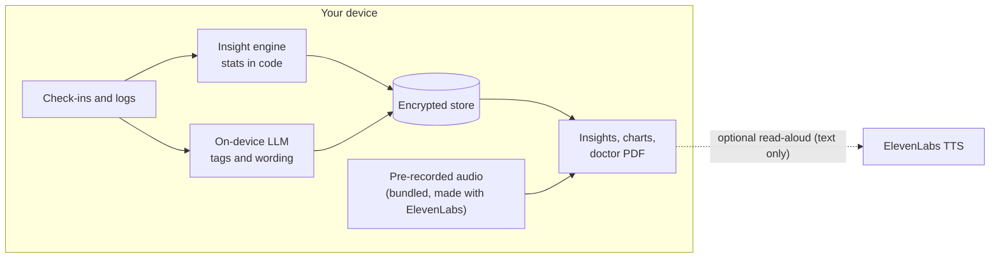

# Ishtar: Private Feminine Wellness Intelligence

> We store your most private and intimate data on your device, so you can benefit from the insights Ishtar draws from it.

**Ishtar talks to you in your language, but your words never leave your phone.**

**Track:** Personal Intelligence, Powered by Your Own Data

**Status:** Ideation-stage project. This repo contains documentation only.

---

## Problem

1. **Data at risk:** "In this information age, we are all at risk of having our personal data being infringed upon by tech companies and mega corporations."
2. **Women are especially exposed:** "Women who use health and wellness apps are particularly poised at having their private and intimate data at the mercy of tech companies who may not always have users best interests at heart."
3. **Gaps in existing solutions:** "Only a small percentage of women use these apps with privacy concerns holding most of them back." Popular apps keep your data on their servers, and some have misused it. The FTC acted against Flo (2021) for sharing period data with Facebook and Google, and against BetterHelp (2023), which paid $7.8 million, for sharing mental health data with advertisers. A Duke University review of 23 popular period and pregnancy apps found 87% shared users' data with third parties.

[Read more →](docs/01-problem.md)

## Solution

Ishtar is a feminine physical and mental wellness app that runs entirely on your device. It has four independent modules (mental health journal, period tracker, symptom tracker, perimenopause tracker), connected insights across them, a one-tap doctor visit summary, and ElevenLabs voice in English, Hindi and Kannada.

**What's new**

- **Voice without surveillance:** ElevenLabs audio in English, Hindi and Kannada; nothing personal is sent.

[Read more →](docs/02-solution.md)

## Key features

- **Mental health journal** (core): 3 quick check-ins a day, each under 15 seconds, no streak-shaming
- **Period tracker**: predictions from your own history, not a generic 28 days
- **Symptom tracker**: pain, sleep, energy, skin, digestion
- **Perimenopause tracker**: trend tracking for hot flashes, night sweats, irregular cycles, mood shifts
- **Connected insights**: every module works alone by default; you choose which modules can compare notes, and Ishtar reveals patterns
- **Doctor visit summary**: a one-page PDF you review, edit and share yourself
- **Guided voice content**: pre-recorded ElevenLabs audio for check-in prompts, breathing and grounding exercises, and night wind-down (English, Hindi, Kannada)
- **Read insights aloud** (optional): ElevenLabs text-to-speech reads insights to you; only the insight sentence is sent
- **Accessibility mode**: voice read-out for women with low vision or who find reading English difficult

[All features →](docs/03-features.md)

## How it works

[Architecture →](docs/04-architecture.md)

## Tech stack

| Layer | Tool |
|---|---|
| Frontend | React + Vite (PWA) |
| Storage | IndexedDB (Dexie) + Web Crypto |
| On-device LLM | WebLLM with Qwen 2.5 1.5B (quantised) |
| Light ML | Transformers.js |
| Insight engine | TypeScript |
| Charts / export | Recharts, jsPDF |
| Voice | ElevenLabs |

[Full tech stack →](docs/05-tech-stack.md)

## Privacy promise

- Your data stays on your device. No account required.
- Consent per module; you choose which modules can compare notes, and you can switch it off at any time.
- PIN lock, encryption at rest, one-tap "delete all my data".
- ElevenLabs never receives journal entries, check-in answers or your voice. Voice journaling stays on-device.
- Not a medical device; Ishtar never diagnoses.
- **We make money from the product, never from the data.**

[Privacy and safety →](docs/06-privacy-and-safety.md)

## MVP scope

24-hour MVP: journal with 3× daily check-ins; period, symptom and perimenopause logging; pattern engine with on-device AI; one-tap doctor visit PDF; ElevenLabs voice for check-ins, breathing and insights (English, Hindi, Kannada); 3 months of sample data for the demo.

[MVP and roadmap →](docs/08-mvp-and-roadmap.md)

## Documentation

1. [Problem](docs/01-problem.md)
2. [Solution](docs/02-solution.md)
3. [Features](docs/03-features.md)
4. [Architecture](docs/04-architecture.md)
5. [Tech stack](docs/05-tech-stack.md)
6. [Privacy and safety](docs/06-privacy-and-safety.md)
7. [Data model](docs/07-data-model.md)
8. [MVP and roadmap](docs/08-mvp-and-roadmap.md)
9. [Business model](docs/09-business-model.md)

## Team

| Field | Value |
|---|---|
| Team name | _TBD_ |
| College | _TBD_ |
| Team ID | _TBD_ |

| Role | Name | USN |
|---|---|---|
| Member 1 (Lead) | _TBD_ | _TBD_ |
| Member 2 | _TBD_ | _TBD_ |
| Member 3 | _TBD_ | _TBD_ |
| Member 4 | _TBD_ | _TBD_ |

## License

[MIT](LICENSE)
