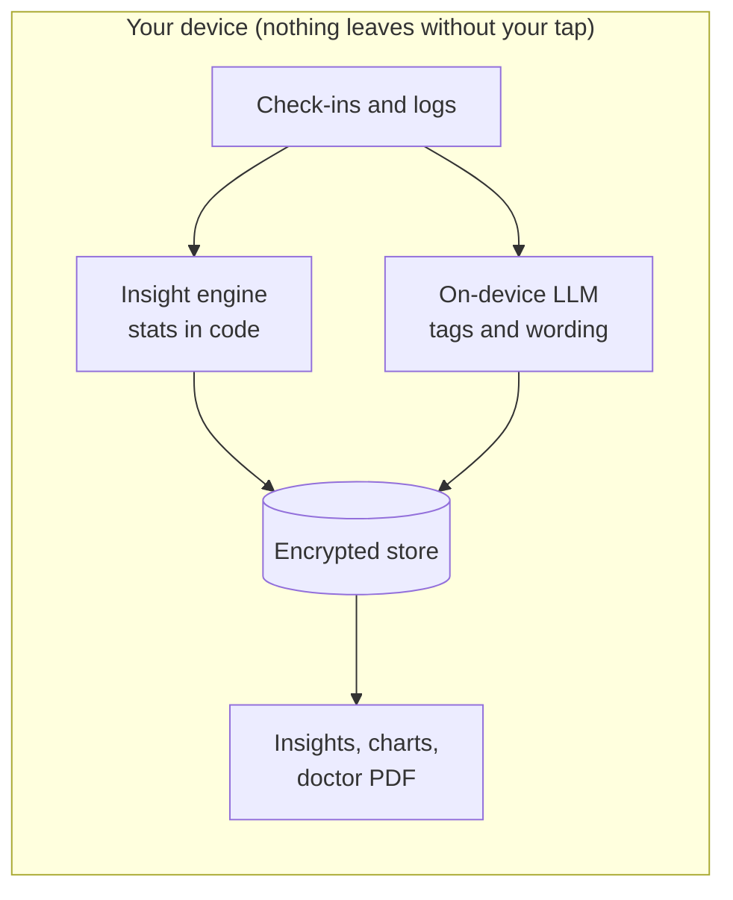

# Ishtar: Private Feminine Wellness Intelligence

> We store your most private and intimate data on your device, so you can benefit from the insights Ishtar draws from it.

**Track:** Personal Intelligence, Powered by Your Own Data

**Status:** Ideation-stage project. This repo contains documentation only.

---

## Problem

Women who use health and wellness apps risk having their most private and intimate data at the mercy of tech companies. It has already happened: the FTC acted against Flo Health (2021) and BetterHelp (2023) for sharing sensitive health data with third parties, and a Duke University review found 87% of 23 popular period and pregnancy apps shared user data. Only a small percentage of women use these apps, with privacy concerns holding most of them back.

[Read more →](docs/01-problem.md)

## Solution

Ishtar is a feminine physical and mental wellness app that runs entirely on your device. It has four independent modules (mental health journal, period tracker, symptom tracker, perimenopause tracker), opt-in connected insights across them, and a one-tap doctor visit summary.

[Read more →](docs/02-solution.md)

## Key features

- **Mental health journal** (core): 3 quick check-ins a day, each under 15 seconds, no streak-shaming
- **Period tracker**: predictions from your own history, not a generic 28 days
- **Symptom tracker**: pain, sleep, energy, skin, digestion
- **Perimenopause tracker**: trend tracking for hot flashes, night sweats, irregular cycles, mood shifts
- **Connected insights (opt-in)**: you choose which modules may "compare notes"
- **Doctor visit summary**: a one-page PDF you review, edit and share yourself

[All features →](docs/03-features.md)

## How it works

[Architecture →](docs/04-architecture.md)

## Tech stack

| Layer | Tool |
|---|---|
| Frontend | React + Vite (PWA) |
| Storage | IndexedDB (Dexie) + Web Crypto |
| On-device LLM | WebLLM with Qwen 2.5 1.5B (quantised) |
| Light ML | Transformers.js |
| Insight engine | TypeScript |
| Charts / export | Recharts, jsPDF |
| Voice (optional) | ElevenLabs TTS |

[Full tech stack →](docs/05-tech-stack.md)

## Privacy promise

- Your data stays on your device. No account required.
- Consent per module; connected insights are opt-in and can be switched off at any time.
- PIN lock, encryption at rest, one-tap "delete all my data".
- Not a medical device; Ishtar never diagnoses.
- **We make money from the product, never from the data.**

[Privacy and safety →](docs/06-privacy-and-safety.md)

## MVP scope

24-hour MVP: journal with 3× daily check-ins; period, symptom and perimenopause logging; opt-in pattern engine with on-device AI; one-tap doctor visit PDF; 3 months of sample data for the demo.

[MVP and roadmap →](docs/08-mvp-and-roadmap.md)

## Documentation

1. [Problem](docs/01-problem.md)
2. [Solution](docs/02-solution.md)
3. [Features](docs/03-features.md)
4. [Architecture](docs/04-architecture.md)
5. [Tech stack](docs/05-tech-stack.md)
6. [Privacy and safety](docs/06-privacy-and-safety.md)
7. [Data model](docs/07-data-model.md)
8. [MVP and roadmap](docs/08-mvp-and-roadmap.md)
9. [Business model](docs/09-business-model.md)

## Team

| Field | Value |
|---|---|
| Team name | _TBD_ |
| College | _TBD_ |
| Team ID | _TBD_ |

| Role | Name | USN |
|---|---|---|
| Member 1 (Lead) | _TBD_ | _TBD_ |
| Member 2 | _TBD_ | _TBD_ |
| Member 3 | _TBD_ | _TBD_ |
| Member 4 | _TBD_ | _TBD_ |

## License

[MIT](LICENSE)
