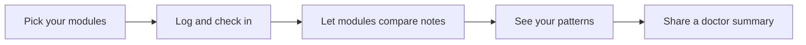

# 2. Solution

Ishtar is a feminine physical and mental wellness app. Its four modules can each be used independently.

## Modules

| # | Module | What it does |
|---|---|---|
| 1 | **Mental health journal** (core) | 3 check-ins a day, each under 15 seconds. |
| 2 | **Period tracker** | Cycles, flow, and predictions from the user's own history (not a generic 28 days). |
| 3 | **Symptom tracker** | Pain, sleep, energy, skin, digestion. |
| 4 | **Perimenopause tracker** | Hot flashes, night sweats, irregular cycles, mood shifts. Uses trend tracking rather than date prediction, because cycles become irregular. |

## Connected insights

Every module works alone by default; you choose which modules can compare notes, and Ishtar reveals patterns.

> Example: "low-mood check-ins cluster 3 days before your period"

## Doctor visit summary

One tap creates a one-page summary: cycle stats, top symptoms and when they occur, mood trends, notable changes, logged medications, and suggested questions to ask. The user reviews and edits it, then exports it as a PDF. Nothing is shared automatically. It never diagnoses; it says "worth asking your doctor about".

## Voice (ElevenLabs)

| Feature | What it does |
|---|---|
| **Pre-recorded guided voice content** | Audio generated with ElevenLabs at build time and shipped inside the app, so no user data is sent at runtime: voice prompts for the 3 daily check-ins, breathing and grounding exercises after low-mood check-ins, and calming wind-down audio for the night check-in. English, Hindi and Kannada. |
| **Read insights aloud** (optional) | ElevenLabs text-to-speech reads insights aloud. Only the insight sentence is sent, never journal text, symptoms or audio. |
| **Accessibility mode** | Voice read-out for women with low vision or who find reading English difficult, combined with the Hindi and Kannada audio. |

## What's new

- **Voice without surveillance:** ElevenLabs audio in English, Hindi and Kannada; nothing personal is sent.

## User flow

---

Previous: [← Problem](01-problem.md) · Next: [Features →](03-features.md) · [Back to README](../README.md)
