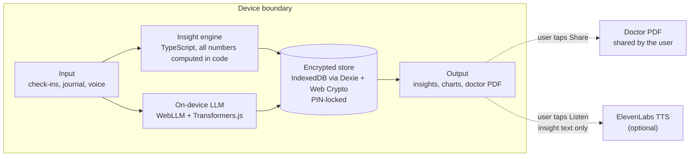

# 4. Architecture

Everything runs on the user's device, in the browser, as an installable PWA. **There is no backend server.**

## Overview

## What can leave the device

Only two things, and only when the user taps:

| What | When | What is sent |
|---|---|---|
| Doctor PDF | The user chooses to share it | The PDF the user reviewed and edited |
| ElevenLabs voice (optional) | The user asks for insights to be read aloud | Insight text only, never journal text or audio |

## Key rule: the LLM never calculates numbers

| Component | Responsibility |
|---|---|
| **Code** (insight engine) | Computes all stats and correlations |
| **LLM** | Tags journal entries, words insights, drafts the doctor summary |

The LLM uses JSON-schema output, with template fallbacks.

---

Previous: [← Features](03-features.md) · Next: [Tech stack →](05-tech-stack.md) · [Back to README](../README.md)
