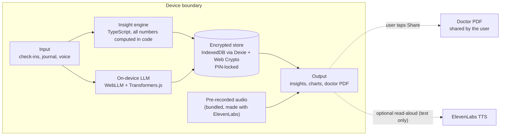

# 4. Architecture

Everything runs on the user's device, in the browser, as an installable PWA. **There is no backend server.**

## Overview

## What can leave the device

Only two things, and only when the user taps:

| What | What is sent |
|---|---|
| Sharing the doctor PDF | The PDF the user reviewed and edited |
| Optional ElevenLabs read-aloud | Insight text only |

Guided audio is pre-recorded and ships with the app, so playing it sends nothing.

## Voice rules

- ElevenLabs never receives journal entries, check-in answers or the user's voice.
- Voice journaling stays fully on-device (Whisper via Transformers.js). We deliberately don't use cloud speech-to-text.

## Key rule: the LLM never calculates numbers

| Component | Responsibility |
|---|---|
| **Code** (insight engine) | Computes all stats and correlations |
| **LLM** | Tags journal entries, words insights, drafts the doctor summary |

The LLM uses JSON-schema output, with template fallbacks.

---

Previous: [← Features](03-features.md) · Next: [Tech stack →](05-tech-stack.md) · [Back to README](../README.md)
