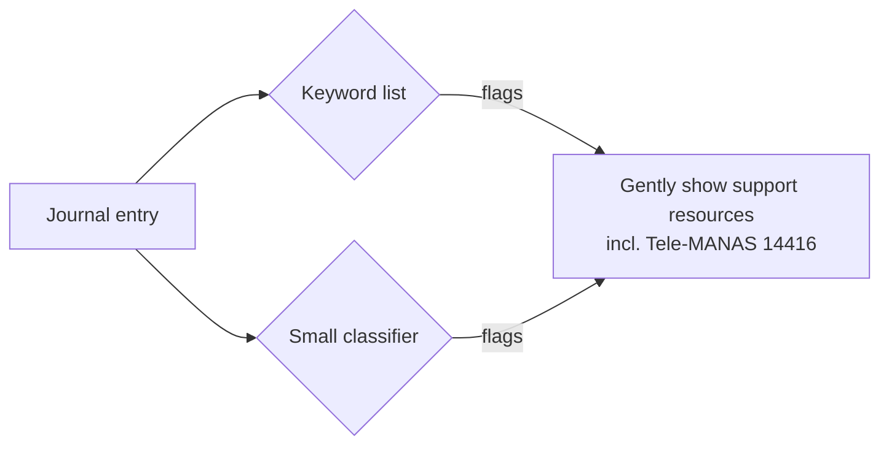

# 6. Privacy and safety

## Privacy

| Principle | How |
|---|---|
| Data stays on the device | No backend server; no account required |
| Consent per module | Every module works alone by default; you choose which modules can compare notes, and you can switch it off at any time |
| Protected at rest | PIN lock, encryption at rest |
| User stays in control | One-tap "delete all my data" |
| Private entries | Entries can be marked private so they're excluded from the doctor summary |

## Voice and ElevenLabs

- ElevenLabs never receives journal entries, check-in answers or the user's voice.
- Voice journaling stays fully on-device (Whisper via Transformers.js). We deliberately don't use cloud speech-to-text.
- Guided audio (check-in prompts, breathing and grounding, night wind-down) is pre-recorded with ElevenLabs at build time and ships with the app, so no user data is sent at runtime.
- Read insights aloud is optional. Only the insight sentence is sent, never journal text, symptoms or audio.

## What can leave the device

Only two things, and only when the user taps:

1. Sharing the doctor PDF
2. Optional ElevenLabs read-aloud (insight text only)

## Safety

### Distress safety net

Ishtar uses a keyword list plus a small classifier. If either flags distress or self-harm language, Ishtar gently shows support resources, including India's **Tele-MANAS helpline (14416)**.

### Not a medical device

Ishtar never diagnoses. The doctor summary says "worth asking your doctor about".

---

Previous: [← Tech stack](05-tech-stack.md) · Next: [Data model →](07-data-model.md) · [Back to README](../README.md)
