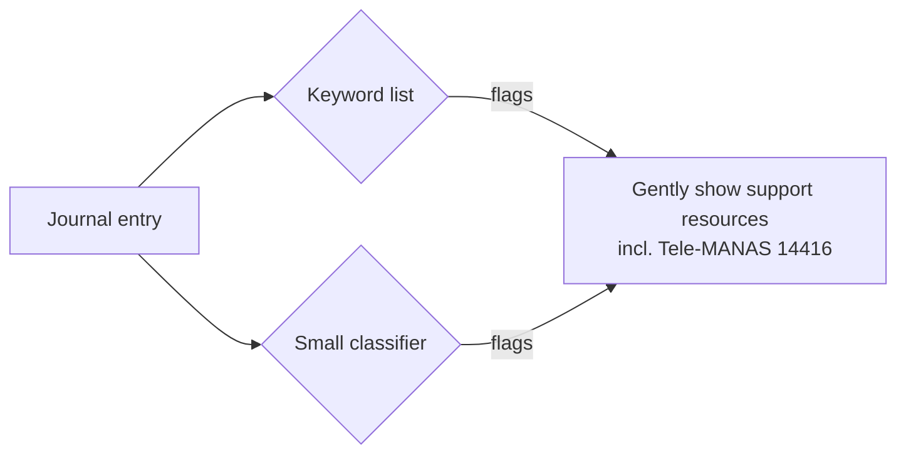

# 6. Privacy and safety

## Privacy

| Principle | How |
|---|---|
| Data stays on the device | No backend server; no account required |
| Consent per module | Connected insights are opt-in and can be switched off at any time |
| Protected at rest | PIN lock, encryption at rest |
| User stays in control | One-tap "delete all my data" |
| Private entries | Entries can be marked private so they're excluded from the doctor summary |

## Safety

### Distress safety net

Ishtar uses a keyword list plus a small classifier. If either flags distress or self-harm language, Ishtar gently shows support resources, including India's **Tele-MANAS helpline (14416)**.

### Not a medical device

Ishtar never diagnoses. The doctor summary says "worth asking your doctor about".

---

Previous: [← Tech stack](05-tech-stack.md) · Next: [Data model →](07-data-model.md) · [Back to README](../README.md)
